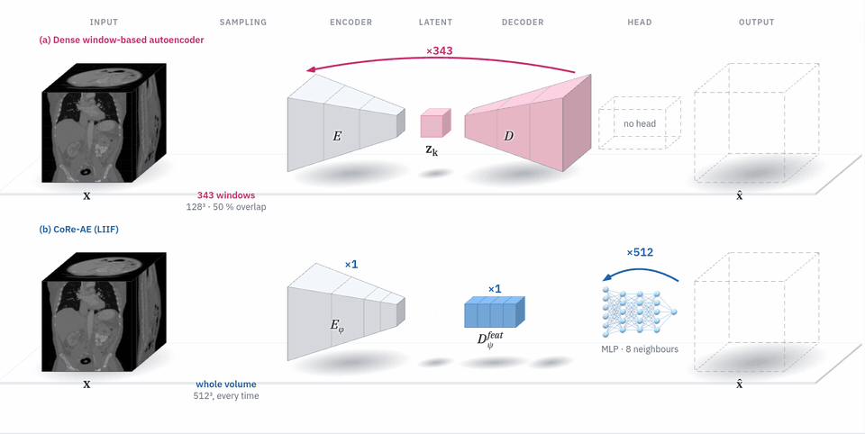
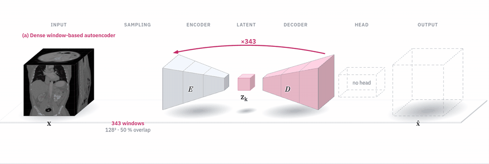
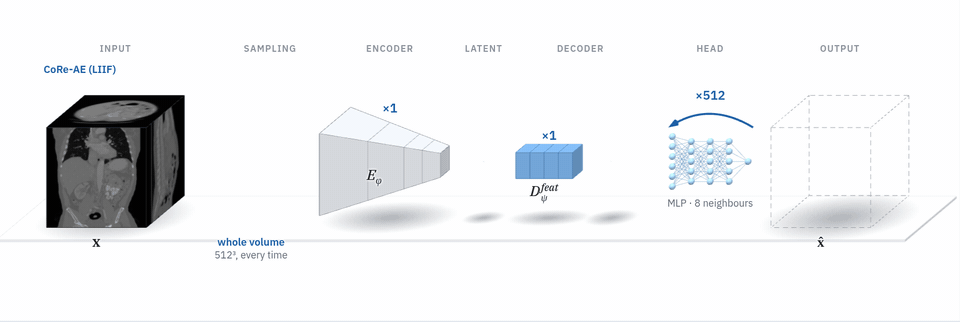
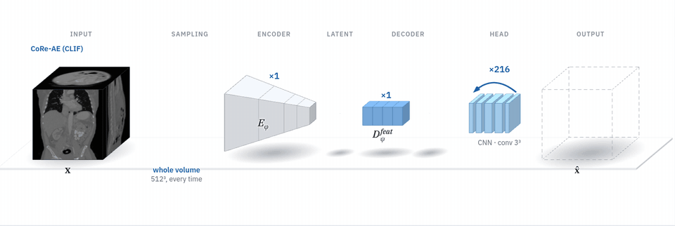

# Continuous 3-D Latent Diffusion: CoRe-AE

<p align="center"></p>

Code and weights for **CoRe-AE**, a 3-D autoencoder with a continuous coordinate decoder, and for the **latent diffusion priors** trained on it. Full CT 512³ and MRI 256³ volumes are encoded once, generated in latent space, and decoded on one GPU, with no overlapping patches and no blending.

> Y. Mellak, A. De Paepe, D. Visvikis, A. Bousse. *Continuous 3-D Latent Diffusion for Medical Image Generation and Reconstruction.* Preprint, 2026.

| | Dense window-based AE | CoRe-AE (LIIF head) | CoRe-AE (CLIF head) |
|---|---|---|---|
| |  |  |  |
| What repeats | full encoder + decoder, 343 overlapping 128³ windows | only the MLP head, 512 chunks of 2¹⁸ queries | only the small CNN head, 216 tiles + 6-voxel halo |

Interactive versions: [`docs/lab/lab3d.html`](docs/lab/lab3d.html) (the animation above) and [`docs/lab/lab2d.html`](docs/lab/lab2d.html) (how LIIF and CLIF render one voxel). Download a file and open it in a browser.

## Contents

- **CoRe-AE**: encoder E<sub>φ</sub>, feature decoder D<sub>ψ</sub><sup>feat</sup> (runs once on the 128³ latent grid) and a rendering head D<sub>ψ</sub><sup>head</sup>:
  - **LIIF**: an MLP on the 8 neighbouring latent cells, rendered in chunks of coordinates;
  - **CLIF**: a small CNN on the output grid, rendered in tiles with a halo.
- **Latent priors**: a 3-D U-Net trained on the latents, with two objectives:
  - **JiT** (x₀-prediction, velocity loss, Heun sampler with 50 steps): the generative model of the paper;
  - **DDPM-ε** (1000-step linear schedule): training code and example weights.
- `inference/` (scripts and notebooks), `c3d` training commands, configs, tests.

Inverse problems (sparse-view CT, accelerated MRI) are not part of this release yet.

## Install

```bash
git clone https://github.com/Mellak/continuous-3d-latent-diffusion
cd continuous-3d-latent-diffusion
pip install -e .            # inference
pip install -e ".[train]"   # + training (CLIF perceptual loss, tests)
```

Python ≥ 3.10, PyTorch ≥ 2.3 (tested with 2.5). A GPU with BF16 support is recommended. Generating a CT 512³ volume peaks at about 5 GiB of GPU memory.

## Quick start

Download the pretrained weights from [Google Drive](https://drive.google.com/file/d/1DDR66MXWVQo1_cxXBF0chNI2JK_ph-vL/view?usp=sharing) before running inference. The weights are distributed separately from this repository. Place each model's files in `weights/<id>/` as described below.

```bash
# Generate (JiT prior, 50 Heun steps) -> NIfTI in HU + PNG preview
python inference/generate.py --prior core-ldm-jit-ct512-liif --num 4 --out outputs/ct
python inference/generate.py --prior core-ldm-jit-mri256-clif --num 4 --out outputs/mri
python inference/generate.py --prior core-ldm-ddpm-ct512-liif --num 1   # DDPM-ε example (1000 steps)

# Encode / decode a volume, report PSNR / SSIM, time and peak memory
python inference/autoencoder.py --model core-ae-liif-ct512 --input ct.nii.gz --out outputs/ae
python inference/autoencoder.py --model core-ae-liif-ct512 --input ct.nii.gz --scale 2   # decode the same latent on a 2× finer grid
```

The notebooks [`inference/autoencoder.ipynb`](inference/autoencoder.ipynb) and [`inference/generate.ipynb`](inference/generate.ipynb) run the same functions and show their outputs.

From Python:

```python
from c3d.hub import load_autoencoder, load_prior, render_kwargs
ae, cfg = load_autoencoder("core-ae-clif-ct512", "cuda")
z, _ = ae.encode(x, sample=False)                                   # x: [1, 1, 512, 512, 512] in [-1, 1]
x_hat = ae.decode_latent(z, (512, 512, 512), **render_kwargs(cfg))  # any output size
```

## Released models

Pretrained weights are available from [Google Drive](https://drive.google.com/file/d/1DDR66MXWVQo1_cxXBF0chNI2JK_ph-vL/view?usp=sharing). Download them manually; the inference commands do not download from Google Drive automatically.

The model loader expects a folder for each model at `weights/<id>/`, containing `model.safetensors` and `config.yaml`. Prior folders also require `latent_stats.json`. Keep any supplied model cards with their models. For example:

```text
weights/
  core-ae-liif-ct512/
    model.safetensors
    config.yaml
  core-ldm-jit-ct512-liif/
    model.safetensors
    config.yaml
    latent_stats.json
```

If you keep the model folders elsewhere, set `C3D_WEIGHTS` to their parent directory before running the commands. Autoencoder weights are 6–19 MB each; prior weights are about 331 MB each and exceed GitHub's 100 MB file limit.

| Id | Model | Data |
|---|---|---|
| `core-ae-liif-ct512` | CoRe-AE, LIIF head | CT 512³ |
| `core-ae-clif-ct512` | CoRe-AE, CLIF head | CT 512³ |
| `core-ae-liif-mri256` | CoRe-AE, LIIF head | MRI 256³ |
| `core-ae-clif-mri256` | CoRe-AE, CLIF head | MRI 256³ |
| `core-ldm-jit-ct512-liif` | JiT prior on `core-ae-liif-ct512` latents | CT |
| `core-ldm-jit-ct512-clif` | JiT prior on `core-ae-clif-ct512` latents | CT |
| `core-ldm-jit-mri256-liif` | JiT prior on `core-ae-liif-mri256` latents | MRI |
| `core-ldm-jit-mri256-clif` | JiT prior on `core-ae-clif-mri256` latents | MRI |
| `core-ldm-ddpm-ct512-liif` | DDPM-ε prior (example) | CT |
| `core-ldm-ddpm-ct512-clif` | DDPM-ε prior (example) | CT |

Latent grids: 4 × 128³ (CT) and 4 × 64³ (MRI). Prior weights are the EMA weights. Each prior folder records its autoencoder and the latent normalisation (`latent_stats.json`).

**Training data.** CT models: **AutoPET** whole-body CT, resampled to **1 × 1 × 1.5 mm** and cropped or padded to 512³, with HU clipped to [−1000, 1500] and scaled to [−1, 1]. MRI models: **IXI** T1-weighted volumes at 256³, normalised with the 1st and 99th intensity percentiles. No images are distributed here; see [`docs/data.md`](docs/data.md).

## Training

One command, `c3d`, driven by a config file. One GPU works as is; for several GPUs put `torchrun --nproc_per_node=N -m c3d.cli` in front. Running the same command again with the same `--out` resumes from `checkpoints/last.pt`.

```bash
# 1. Autoencoder (configs/ae/{ct,mri}_{liif,clif}.yaml)
c3d train-ae --config configs/ae/ct_liif.yaml --data /data/ct --out runs/ct_liif
#    or continue from released weights:  --mode finetune --init core-ae-liif-ct512

# 2. Encode the training volumes (posterior mean) and compute latent statistics
c3d export-latents --ae runs/ct_liif --data /data/ct --out latents/ct_liif     # --ae core-ae-liif-ct512 also works

# 3. Prior (configs/prior/{ct_jit,ct_ddpm,mri_jit}_{liif,clif}.yaml)
c3d train-prior --config configs/prior/ct_jit_liif.yaml --latents latents/ct_liif --out runs/ct_liif_jit

# 4. Sample from your run (EMA weights)
c3d sample --prior runs/ct_liif_jit --num 4 --out samples/
```

Change any setting without editing the file: `--set training.lr=1e-4 --set training.epochs=500`.

Notes:
- The configs are the saved configs of the released weights. Only the data path, the initial checkpoint and the GPU count are left open.
- LIIF is trained with L1 + KL on 200 000 random coordinates per iteration. CLIF is trained on 64³ tiles with L1 + KL plus perceptual and adaptive adversarial terms (`training.losses` in its config). The perceptual loss needs `monai-generative`.

## Repository

```
c3d/            package: models (CoRe-AE, heads, 3-D U-Net), diffusion (JiT, DDPM), data, losses, training, hub, cli
configs/        ae/*.yaml, prior/*.yaml
inference/      autoencoder.py / .ipynb, generate.py / .ipynb, common.py
scripts/        export_release_weights.py, record_lab_animations.py
weights/        pretrained models downloaded separately from Google Drive
docs/           lab/ (interactive pages), media/ (animations), data.md
tests/          heads, end-to-end pipeline, equivalence with the original research code
```

```bash
pytest tests/        # test_equivalence.py runs only when the original research code is available
```

## Citation

```bibtex
@article{mellak2026continuous,
  title   = {Continuous 3-D Latent Diffusion for Medical Image Generation and Reconstruction},
  author  = {Mellak, Youness and De Paepe, Antoine and Visvikis, Dimitris and Bousse, Alexandre},
  journal = {Preprint},
  year    = {2026}
}
```

## License

Code: [Apache-2.0](LICENSE). Weights: [CC BY-NC-SA 4.0](MODEL_LICENSE.md), for research use only and not for clinical use. Please also credit the AutoPET (TCIA) and IXI datasets.

Funding: CPER 2021–2027 IMAGIIS (INNOV-XS). HPC resources: IDRIS, allocation 2026-AD011018234.
